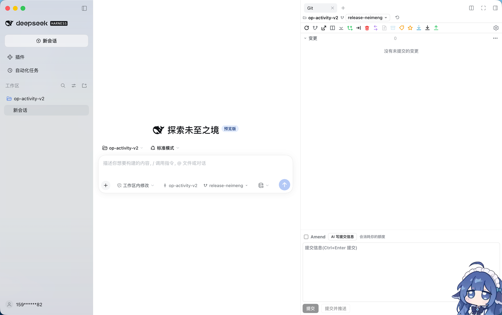
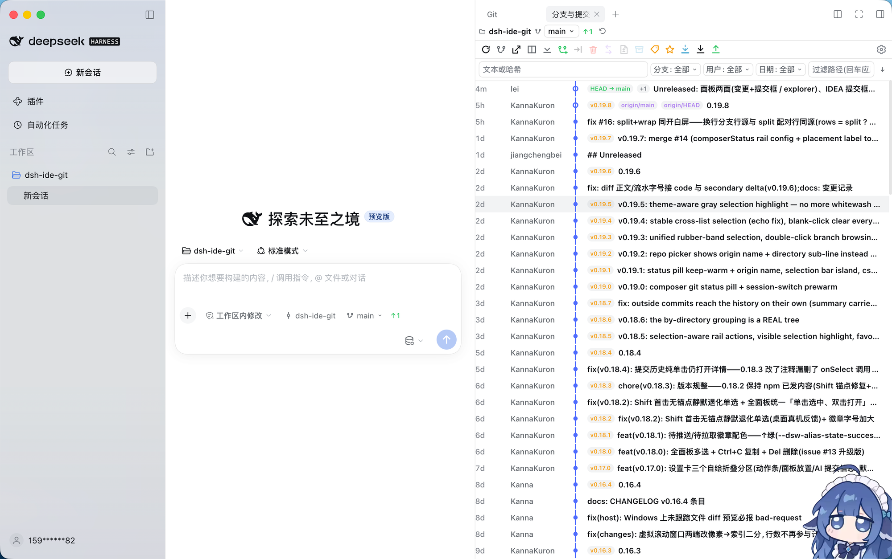

# dsh-ide-git

[](https://awesome-dsh-plugin.com)

简体中文 | [English](README_EN.md)

> 给 [DeepSeek Harness (DSH)](https://github.com/deepseek-ai/deepseek-harness) 装一个 **IDE 级的 Git 工具窗口**——日常那个页签只放**变更 + 提交框**,点动作条上的**分支图标**另开一个 **explorer 页签**:左边分支树、中间提交图谱、右边提交详情,操作方式对齐 JetBrains 系 IDE 的 Git 面板;以 [dsh-better-sidebar](https://github.com/omdsh-dev/DSH-better-sidebar) 原生 Tab 的形式注册,右侧栏与底部工作台都能用;没装底座时自动接管 DSH 原生右侧栏,还可以挂在**主对话区**(「对话 / 轨迹」旁边的 Git 标签页,设置里可关)。
>
> explorer 页签**不占用侧栏「开始」页的卡片位**——它只为分支图标而开,平时不现身。

DSH 自带的 Git 面板覆盖「暂存 / 提交 / 还原 / 看历史」;`dsh-ide-git` 补齐 IDE 用户习惯的那一层:**分支树 + 右键分支操作 + 提交图谱 + 提交详情 + 变更列表 + 提交框**,外加一个 SCM 风格的分组命令菜单。

## 它解决什么

- **分支管理没有树**:内置面板只有一个分支下拉。这里给出 `HEAD(当前分支) / 本地 / 远程 / 标签` 的分组树,每个分支带 ahead/behind 角标、上游、worktree 占用标记(`W`)。
- **历史只是列表**:这里画出提交图谱(lane 拓扑 + 分支/标签 ref 徽章),支持无限滚动加载、框选批量选中与过滤(文本 / 哈希 / 作者 /「我」);**历史范围**可在当前分支 / 全部分支 / 任意本地或远程分支之间切换——别的分支领先的提交不再因为不在当前分支祖先链上而看不见;双击分支直接浏览该分支历史(不强制签出),有合并关系时自动定位到两分支最近的合并点。
- **想看某个提交改了什么**:点提交直接进详情——作者、日期、完整提交信息、变更文件(含 +/− 行数),点文件看逐行 diff(红绿 + 行号 + hunk 高亮)。
- **想指给 AI 一段代码**:在 diff 窗里选中几行、右键,把「哪个文件哪几行」(附提交或工作区上下文)直接发进当前会话的输入框。
- **想比较分支**:分支右键即可与当前分支比较,结果按文件与提交数汇报。
- **操作要够全**:签出、从任意分支/提交新建分支、重命名、删除、合并到当前(默认 / `--no-ff` / `--squash` / `--no-ff --no-commit`;留下待提交的合并后可在「更多操作 → 提交 → 中止合并」退出)、变基当前到此、新建标签、cherry-pick、还原提交、重置(保留/丢弃)、fetch / pull(含 `--ff-only`)/ push(确认后);外加 `⋯ 更多操作` 里按 SCM 分组的提交 / 更改 / 拉取推送 / 远程 / 存储 / 标记,以及克隆仓库与远程管理——日常那几十条命令不用切终端。
- **卡住时知道卡在哪**:面板加载超过 2 秒会出现诊断条——分段进度(fetch / summary / stats / branches / log)、当前活动 git 子命令与已运行时长;宿主 2.5 秒不应答时提示「宿主无响应」,并可一键复制诊断 JSON。正常加载与后台轮询不显示诊断条。
- **输入框里就能看 Git**:输入框工具条上是**仓库胶囊 + 分支胶囊**加三色计数(着色的未提交 / 可拉取 / 待推送)。点仓库名直接打开右侧 Git 面板,仓库名旁的箭头切换仓库(单仓库工作区没有箭头);点分支名弹出可搜索的切换器——仓库按名称/路径过滤,分支按 `/` 折成文件夹树(`fix/xxx` 一眼看清),输入即滤、方向键 + Enter 可选,与面板实时联动。选择器里还有「打开其他仓库…」,输入绝对路径即可把工作区外的仓库加入并按会话记住。仓库胶囊有单独开关、整条状态条也有总开关,都在设置 →「面板放置」(默认开)。切到新会话也不用等——插件会在你点开会话时就预热首屏数据,面板秒开。

## 效果

> 两张图取自一个**正在运行的 DSH** 右侧栏里的 Git 面板:图 1 是**默认页签**(变更 + 提交框),图 2 是**explorer 页签**(分支与提交,即提交列表 + 图谱)。两面是同一个注册、同一份状态,由动作条上的**分支图标**来回切换。

<table>
<tr>
<td align="center" width="58%"></td>
<td valign="top"><b>默认页签:变更 + 提交框(右侧栏)</b><br/>窄而高的右栏里量出的是紧凑布局:顶栏一行(仓库胶囊 + 分支切换 + 刷新),下面一条<b>横排动作条</b>——<b>分支图标</b>就是通往 explorer 页签的那扇门。主体是变更区(这张图的仓库是干净的,所以写着「没有未提交的变更」)与 <b>IDEA 式提交框</b>:<code>Amend</code> 与「AI 写提交信息」在提交信息<b>上方同一行</b>,「提交 / 提交并推送」贴<b>左下角</b>;拖动提交框的<b>上边框</b>就能改高(双击复位、方向键微调)。</td>
</tr>
</table>

<table>
<tr>
<td align="center" width="58%"></td>
<td valign="top"><b>explorer 页签:分支与提交</b><br/>同一个面板的另一面(标签页就叫「分支与提交」)。提交列表的列序与 IDEA 一致(<b>日期 → 提交人 → 图谱 → 分支标签 → 提交信息</b>),lane 拓扑把父子关系连成整行;右侧是版本标签与 <code>HEAD → main</code> 徽章。上方一排筛选(文本或哈希、分支或标签、提交人、日期、路径)与排序方向;双击分支浏览它的历史(不强制签出)。</td>
</tr>
</table>

## 安装

本插件**从仓库地址安装**:

```sh
# 本插件
dsh plugin --profile web add git+https://github.com/New2Niu/dsh-ide-git.git

# 可选底座:装了它才会多出底部工作台,并跟随它的侧栏布局
dsh plugin --profile web add dsh-better-sidebar

# 重启 dsh web
```

DSH 侧栏的「插件」页认同一个仓库地址:把 `git+https://github.com/New2Niu/dsh-ide-git.git` 粘进安装框、或在对话里让 Agent 装,效果相同。本仓库没有安装期构建脚本,正常不会触发 pnpm 的 `allowBuilds` 审批;若宿主提示需要放行脚本,按它打印的包名加进 profile 的 `pnpm-workspace.yaml` 再重试。

装好后打开任意会话:

- **只装本插件**:点会话头右侧的「打开右侧边栏」→ Guide 页里的 **Git** 胶囊 → 默认页签打开;点它动作条上的**分支图标** → 同一列里新开 **explorer** 页签;点文件或提交的「显示差异」→ 差异开在同列的 **Git 预览** 页签;
- **装了底座**:会话头右侧的面板开合按钮 → 面板 Tab 条右侧 `+` → 选 **Git**(底部工作台);点该面板动作条上的**分支图标**即新开 explorer Tab,「显示差异」交给底座自带的 diff 标签页。原生右侧栏的 `+` → **Git**(同一注册,同一份状态);
- 底座在场时,它的设置页 **侧边卡片** 分区里也会出现本插件的卡片(标题 / id / 启用开关),随时停用;插件自有开关在 DSH 设置里的 **Git 工具窗口** 卡片(面板放置、输入框 Git 状态、动作条、AI 提交信息)。

### 兼容性

- `engines.dsh` 与 `@deepseek-ai/dsh` 的 peerDependencies 自 v0.28.0 起都声明为 **`>=0.2.2-rc.1`**,范围是**开放下界、不封顶**。兼容门禁实际优先读 `engines.dsh`(存在时忽略 peer),peer 同步声明并标 optional,是给包管理器与排障看的第二份声明。
- 设置面单代:`>=0.2.2-rc.1` 的 `ctx.configForms` 是唯一来源,行 Config 的每个字段都可写;设置卡负责逐动作显隐、面板放置、日期格式与 AI 提交信息,排序由面板齿轮里的编辑器写 `railOrder`。旧的 `localStorage` 配置只在升级时读取一次,写路径已删除;加载中显示加载态,只有表单不可用时才显示不可用。模型徽章等宿主可选数据仍按能力探测,不按版本号分支。
- **dsh 0.2.2-rc.1(v0.27.3)**:右侧栏新增的 `direction` / `isFloating` 字段与工作区菜单内部迁移不影响本插件使用的能力;`sidebarRight.openTab` / `openResource` / `float` / `dock`、composer 槽与官方 `contextMenus` 均按原契约工作。
- **dsh 0.2.2-rc.2**:官方 `Menu` 删除 `getAnchorRect`,改用 `anchorRef`(元素锚点)与 `anchorPoint`(坐标锚点);仓库/分支选择器走的仍是保留的 `anchor` 节点路径,无需改代码。`ui-workspace` 删除的 `openWorkspaceMenu` / `openSessionMenu` 注入本插件未使用,`contextMenus.open` 新增的可选 `{button}` 向后兼容。`sidebarRight`、composer 槽与 `contextMenus` 契约未变。
- 只依赖三样长期契约:宿主半的 `webServer.register({ kind: 'prefix' })` 路由、客户端半的 `window.__ModuleLoader__.load({ id, factory })`、以及客户端的 `slots` 服务。**图标全是自带 SVG**(不引用 `ui-primitives` 的图标集),所以宿主删改图标不会波及本插件;diff 正文优先用宿主自带的 `DiffBlock` 组件渲染,拿不到就退回自绘行。
- 底座是**可选** peer:没装、装坏了、或它自己要等上游修,都不影响本插件挂到原生右侧栏。

## 面板:两个面,三处座位

### 两个面(同一注册,同一份状态)

| 面 | 里面是什么 | 怎么打开 |
|---|---|---|
| **默认页签** | **变更 + 提交框**。三种 chrome 下都是单列:变更分组在上,提交框在下,中间那根可拖的分隔条就是提交框的上边框 | 从侧栏卡片 / `+` 菜单 / 开始页胶囊点 **Git** |
| **explorer 页签** | **分支树 \| 提交图谱 \| 提交详情**。`columns` 下三栏并排(详情列复用变更列的宽度与分隔条,未选中提交时显示提示);窄栏 / 堆叠下树在上、提交列表与详情在同一主区里互换、diff 在下 | 点默认页签动作条上的**分支图标**(同一枚按钮在 explorer 里变成折叠 / 展开分支树);它**不进** `+` 菜单、**不占**开始页卡片,只为这枚按钮而开 |
| **Git 预览** | 单个文件 / 单个提交补丁的逐行 diff,带复制整份补丁、刷新与「打开文件预览」(跳到宿主的整文件阅读器) | 「显示差异」的落点:没有底座时开在原生右侧栏的这一页签;有底座时改为底座的 diff 标签页;两者都不可用才内嵌在面板里 |

面板不猜自己是谁,而是用 `ResizeObserver` 量自己的容器:宽 < 400px 走 `compact`(单行头部 + 动作条一行),宽 ≥ 600px 且宽 ≥ 高 × 1.15 走 `columns`(三栏),其余走 `stack`(纵向)。**宽度说了算,高度没有否决权**——所以 1500×300 的底部工作台不会被误判成窄栏。自由浮窗与移动端抽屉同样自适应。

### 三处座位(注册只发生一次)

本插件注册一次,落到哪个面上由**宿主**决定,几条通道互斥:

| 宿主 | 条件 | 你得到什么 |
|---|---|---|
| **dsh-better-sidebar**(底座,可选) | 装了它 | 它的 Tab 系统:右侧栏里的原生 Tab **加上底部工作台**;它的设置页 `侧边卡片` 里能看到本插件的卡片 |
| **DSH 原生右侧栏** | 没装底座时自动接管 | 右侧栏 Guide 页里的 **Git** 胶囊 → 点开就是同一个面板;explorer 与 **Git 预览** 作为同列的额外页签按需打开(都不写 `guide`,开始页始终只有一张卡片) |
| **主对话区标签页**(v0.13.0 起) | 总是可用(可在设置里关闭) | 会话顶部「对话 / 轨迹」旁多一枚 **Git** 标签,点它整块主对话区变成 Git 工具窗口;开关在插件设置 →「面板放置」 |

底座在场时以它为准(它还带底部工作台);底座**晚到**会顶掉原生注册再挂到它那边,底座**消失**(被停用 / 卸载)也会立刻退回原生座位,面板不会跟着消失。所以**只装本插件也能用**,没有任何前置要求。

| 面 | 形态 | 本插件的布局 |
|---|---|---|
| 右侧栏(原生的,或底座桥接过来的) | 窄而高 | 默认页签走 `compact`:单行头部 + 动作条一行 + 变更 + 提交框;explorer 页签走 `stack`:分支树可收起,提交列表 / 详情 / 差异在同一主区里换 |
| 底部工作台(底座自有) | 宽而扁 | 默认页签:左侧竖排动作条 + 变更 + 提交框;explorer 页签走 `columns`:分支树 · 提交图谱 · 提交详情**三栏并排**——就是 JetBrains Git 工具窗口的样子 |

## 功能一览

| 区域 | 能力 |
|---|---|
| 动作条 | 16 个动作的 IDEA 式条(底部工作台竖排 / 右侧栏横排一行):刷新、分支图标、浮动·分栏·全屏(宿主 dock 服务存在时才渲染)、新建分支、签出、删除、比较、显示差异、贮藏、新建标签、收藏、抓取、拉取、推送。**按可用空间自动决定放几个**,放不下的收进 `⋯ 更多`;末尾 `⚙ 设置` 可拖动排序、逐项显隐(存 `dsh-ide-git.rail.v1`,设置卡片里也能勾)。每个按钮按当前状态点亮 / 置灰(没有其他分支就不能删除 / 签出 / 比较,没有远程就不能抓取 / 推送,没有上游就不能拉取,没有变更就没有差异可看)。**分支图标是一枚两用按钮**:默认页签里点它 = 新开 explorer 页签,explorer 页签里点它 = 折叠 / 展开最左的分支树 |
| 顶栏 | 仓库选择器、分支切换、`↑ahead ↓behind`、未结束的 merge / rebase / cherry-pick / revert / bisect 提示、「最近可撤回的操作」,忙碌时右侧显示指示;`⋯` 里的「显示 Git 输出」会摊开最近 git 运行的 argv / 退出码 / 耗时 / 输出,用于自查 |
| `⋯ 更多操作` | SCM 风格的分组菜单:**查看和排序**(平铺 / 按目录 / 按路径 / 按名称 / 按状态 / Git 顺序,全部展开 / 折叠,显示忽略的文件)、**提交**(提交已暂存 / 全部提交,加上 amend 与已签收变体、撤销上次提交)、**更改**(放弃所有更改)、**拉取推送**(同步、同步变基、拉取变基、从远程拉取、推送 / 强制推送 / 推送到远程、发布分支)、**远程**(从所有远程抓取、添加 / 删除远程)、**分支**(删除远程分支)、**存储**(贮藏已跟踪 / 已暂存,应用 / 弹出 / 删除指定贮藏、删除全部)、**标记**(删除标签 / 远程标签、推送标签)、克隆、中止变基、显示 Git 输出 |
| 仓库 | 自动识别工作区与其下的子仓库;多仓库工作区里用仓库选择器切换;可克隆仓库(URL + 目标目录) |
| 输入框状态条 | 宿主输入框工具条里的**仓库胶囊 + 分支胶囊**加三色计数(着色 ±未提交 / ↓可拉取 / ↑待推送):**点仓库名打开右侧 Git 面板**;箭头切仓库(单仓库工作区没有箭头)、点分支名切分支,与面板双向联动。两个开关都在设置 →「面板放置」(默认都开),关掉「输入框显示仓库胶囊」就只留分支与计数 |
| 分支树 **(explorer)** | `HEAD / 本地 / 远程 / 标签 / 收藏` 分组(可折叠)、过滤框、星标当前分支、ahead/behind 角标、worktree 占用标记;本地蓝 / 远程紫 / 标签黄 / HEAD 绿 |
| 分支右键 | 签出、将当前分支变基到此、合并到当前分支、与当前分支比较、从该分支新建分支、重命名、删除(当前分支禁用)、更新(Fetch)、推送、发送到对话(分支名 + 仓库);框选多选后还能一次删除所选引用 |
| 历史筛选 **(explorer)** | 文本或哈希、分支或标签、提交人(含一键「我」)、日期(今天 / 近 7 天 / 近 30 天 / 今年),外加排序方向(新→旧 / 旧→新)与一键清除;路径筛选回车后由 git 服务端过滤(`git log -- <path>`) |
| 提交列表 **(explorer)** | 列序对齐 IDEA:**日期 → 提交人 → 图谱 → 分支标签 → 提交信息**;lane 拓扑图整格连线(相邻行像素对齐)、HEAD 空心点、refs 徽章(HEAD 绿 / 本地蓝 / 远程紫 / 标签黄,最多 3 个 + `+n`)、加载更多 / 无限滚动(每页 120)、三列表框选批量选中 |
| 提交右键 | 提交详情、复制修订号、签出该修订(确认)、在此新建分支、新建标签、cherry-pick、还原提交、重置到此(保留 / 丢弃更改)、发送到对话(短哈希 + 提交信息 + 仓库) |
| 提交详情 **(explorer)** | 完整提交信息、作者 / 日期、变更文件列表(+/−),点文件看逐行 diff;够宽时与提交列表同屏并列,窄栏里替换列表显示且带「返回历史」 |
| 差异 | 内嵌 diff 用 DSH 自家 DiffBlock 渲染(红绿底 + 复制 / 换行工具栏);**Git 预览** 页签用内置的 LineDiff(单栏双列行号 / 左右对比、双侧高亮、± 统计、单边强制单列、5000 行截断);高度可拖拽调节并按位置记忆;内嵌 diff 头部还有「在右侧栏打开」:在右栏新开(或复用)一个「差异」Tab 显示同一份差异,内嵌保留、可随时来回切换,多文件补丁跟随当前文件,没有可用右栏或差异仍在加载时按钮禁用并说明原因;**选中 diff 行右键**把行级引用发进对话 |
| 变更列表 | 冲突 / 已暂存 / 更改 / 未跟踪 四组(带计数与忽略数),行内 暂存 / 取消暂存 / 丢弃 / 复制名称(可多选),分组级「全部暂存 / 全部取消暂存」,点击行看 diff |
| 提交框 | IDEA 式排布:**上面一行**是 **Amend**(`--amend`)勾选 + AI 写提交信息(**Amend 在前**),中间是多行提交信息,**左下**是「提交 / 提交并推送」;**上边框可上下拖动**改高(双击复位、方向键微调),`Ctrl+Enter` / macOS `Cmd+Enter` 提交,回车只换行。AI 生成会先在面板里确认是否覆盖草稿,一键可恢复 |
| 文件右键 | 显示差异、暂存 / 取消暂存、丢弃更改、复制路径、发送到对话(`@文件` 引用 chip 或文件路径) |
| 设置卡片 | DSH 设置里的 **Git 工具窗口** 卡片:**面板放置**(主对话区 Git 标签页、沉浸模式)、**输入框 Git 状态**、**动作条**(逐项勾选)、**历史列表**(默认面历史窗口开关,默认隐藏)、**AI 提交信息**(模型 / 思考强度 / 补充提示词,留空即跟随当前会话) |
| 安全与撤回 | 删除分支 / 贮藏 / 丢弃更改后右下角弹提示条,点「撤回」即可恢复(真删除 + 按动手前记下的对象 id 或文件字节快照重建,一次性、30 分钟内有效),顶栏的撤回图标里也能找到最近操作;`main`/`master`/`trunk` 的删除要求输入分支名确认,所有破坏性确认框焦点默认在「取消」;同一仓库的写操作在宿主串行执行;仓库里还有未结束的 merge / rebase / cherry-pick / revert / bisect 时,相关动作全部置灰并说明原因;强制推送走 `--force-with-lease` |

> 默认页签只放日常提交要用的两件事——**变更 + 提交框**;标着 **(explorer)** 的能力在 explorer 页签里,那是同一个面板的另一面,由动作条上的**分支图标**打开。

## 右键发送到对话

面板里的一切都能右键塞进**当前会话的输入框**——走 DSH 官方的 composer 插入通道(不动你已输入的文字,追加在末尾;发送中或服务不在时自动退化为复制到剪贴板并提示,绝不死点击):

- **提交** → `git 提交 47ad017「提交标题」(仓库 xxx)`:短哈希 + 提交信息 + 仓库,一段话指名一个修订;
- **分支** → `git 分支 main(仓库 xxx)`;
- **文件**(变更列表与提交详情的文件行)→ 一个 `@路径` 文件引用 chip(DSH 原生 @ 语法,含空格的路径自动加引号),或者只发文件路径;
- **diff 选中行**:在提交详情或工作区变更打开的 diff 窗里**选中一段文本再右键** → 「发送选中行到对话」:`@文件` chip + 行号说明——提交场景是「第 N–M 行(提交 47ad017「标题」@ 当前分支)」,工作区场景是「第 N–M 行(工作区已暂存 / 未提交)」。行号由选区所在的 diff 行按 hunk 头换算成**新文件行号**;选中的全是删除行时用旧号并标注「旧行号」。选区落不到可定位的 diff 行上时,菜单退化为「发送选中片段到对话」(原文截断 600 字符),不编造行号;菜单里同时有「复制选中引用」。没有选区时右键保持浏览器默认菜单。

配套已经就位的几件事:变更文件行与详情文件行的行首图标按扩展名着色(DSH 自家 FileTypeIcon);diff 预览用 DSH 自家 DiffBlock 组件渲染(红绿底、复制 / 换行工具栏,视觉与宿主一致);diff 窗高度可拖拽调节并按位置记忆;整个面板还可以挂进**主对话区**——「对话 / 轨迹」旁的 Git 标签页,插件设置里可关。

## 工作原理

```
宿主半 src/index.js + src/host/          客户端半 src/client.js
  POST /dsh-ide-git/api/<method>            有底座:betterSidebar.registerTab ×2
  └─ spawn('git', argv, { cwd })              ├─ dsh-ide-git:panel    默认页签(变更 + 提交框)
     └─ 会话工作区 = cwd                      └─ dsh-ide-git:explore  explorer(hidden)
        (客户端 scope.cwd 传入)              没有底座:sidebarRightTabs.register ×3
                                              ├─ ide-git           主面板(唯一有 guide 胶囊)
                                              ├─ ide-git-explore   explorer(无 guide)
                                              └─ ide-git-preview   Git 预览(无 guide)
                                            主对话区:conversation.view 标签页(设置可关)
                                            Panel:ResizeObserver → columns / stack / compact
```

- **宿主半**:一个前缀路由 `/dsh-ide-git/api`,方法表 54 个(`version` / `repos` / `openRepo` / `summary` / `branches` / `log` / `commitDetail` / `diff` / `compare` / `stage` / `commit` / `merge` / `rebase` / `cherryPick` / `stash*` / `tag*` / `remote*` / `clone` / `gitLogs` / `diagnostics` / `undoList` / `undoApply` / …)。所有 git 调用都是 **argv 数组 + `spawn`**(没有 shell 字符串、没有 `exec`),参数先过校验(绝对路径、ref 不以 `-` 开头、无控制字符、路径不越出仓库)。
- **客户端半**:无构建、单文件、`window.__ModuleLoader__.load({ id, factory })` 包装,只 `require('react')`(DSH 客户端基线模块白名单内)。
- **信任围栏**:路由挂在 DSH 自己的 web server 上,天然同源;只有 Host 为 loopback,或浏览器标记 `Sec-Fetch-Site: same-origin/same-site` 的请求才会被服务。
- **破坏性操作**:`push` / 硬重置 / 强制删分支 / 丢弃未跟踪文件 / 删除 stash 都必须显式 `confirm: true`,UI 侧一律弹二次确认(唯一例外是「提交并推送」按钮,按钮文案已写明会推送,它仍然把 `confirm: true` 传给宿主)。

## 界面语言

跟随 DSH 的语言设置(`ctx.locale`)实时切换,内置 **21 种**词典:简繁中文(含 `zh-HK` / `zh-MO` / `zh-TW`)、英语、日语、韩语、德语、法语、意大利语、葡萄牙语、俄语、荷兰语、波兰语、瑞典语、土耳其语、印尼语、越南语、泰语、印地语、阿拉伯语。词典同时注册进 DSH 的 locale 注册表(`ctx.locale.register`);解析顺序是「精确 tag → 主语言子标签 → 英文」,而**英文始终是键完整的那本**,所以任何未覆盖的语言都回退英文,不会露出键名。

词典就在 `src/client.js` 的 `LOCALES` 表里:一门语言一个条目,条目前面有一行 `/* locale: <tag> */` 标记。**校验是自动的**——冒烟测试强制每本词典的键集与中文完全一致(缺键会静默回退英文,面板就成了半翻译状态,那正是这条测试要挡住的)。

> **与 main(v0.32.0)合并后的分工**:宿主半已拆成 `src/index.js` + `src/host/*.js`(方法表 54 个);默认页签只放「变更 + 提交框」(历史窗口默认隐藏);在设置 →「历史列表」打开「在默认面显示历史列表」后,下方才出现 main 的「历史 / 差异」双页签,分支树 / 提交列表 / 提交详情留在 explorer 页签。提交列表日期列可在设置里切相对 / 绝对时间,合并对话框可选 `--no-ff` / `--squash` / 不提交;工作树视图、在面板内预览差异的开关、仓库 / 分支可搜索切换器、「打开其他仓库…」手动入口(按会话记住最近 8 条)、子目录会话绑定仓库顶层、合并提交的差异、未合并分支删除二次确认与**慢加载诊断条**(诊断只读、不进写队列)都来自 main。设置面单代 `dsh >=0.2.2-rc.1`,`engines.dsh` 与 peer 都是开放下界、不封顶。

## 限制与路线图

- **已经做完的旧路线图项**:三列表框选与批量操作、无限滚动、收藏分支、双击浏览分支历史、diff 行级引用发进对话、插件自有设置(面板放置 / 动作条 / AI 提交信息)——都已在当前版本里。
- **还在路上**:
  - Changelist(按意图把变更分组、分块暂存到同一个提交);
  - 交互式变基(`rebase -i`)、fixup / squash、补丁(`format-patch` / `apply`);
  - 三方合并冲突编辑器与冲突解决动作(接受本地 / 远端)——冲突文件目前只有分组与逐行 diff;
  - blame / 文件历史视图、行级注释;
  - 设置页的插件自有开关(提交后自动刷新、diff 上下文行数等)。
- **只面向 `web` profile**:`dsh.client.platform` 为 `web`;桌面客户端的 renderer 复用同一套 shell 资产,但尚未真机验证。
- **不写 `.git`**:所有操作都通过 `git` 命令走正常索引 / 引用,插件不直接改 `.git` 内部文件。
- **大仓库**:提交列表分页(120/页),diff 输出上限 400KB(超出截断并标记)。

## 开发

```sh
npm test   # 四层,共 119 项
#   smoke:文件级不变量——清单一致性、客户端包装、require 白名单、破坏性确认守卫、
#         方法表、尺寸核心、词典键集(每门语言与中文逐键比对)
#   api:  临时真实仓库直驱宿主路由——解析、暂存 / 提交 / 分支 / 标签 / stash、全部守卫与信任围栏
#   graph:提交图谱的 lane 布局
#   repos:工作区与子仓库解析
```

真机回归用 `scripts/` 下的探针(都要一个**隔离**实例:独立 `DSH_HOME` + 独立端口,别碰自己在用的 `dsh web`):`ssr-check`(客户端半的 SSR 自检)、`layout-probe`(从 480 拉到 90px 逐档记录 chrome,两面都扫)、`panes-probe`(窗格拖动与按面记忆)、`dock-probe`(浮动 / 分栏 / 全屏)、`selection-probe`(框选与批量)、`conversation-probe`(主对话区座位与提交框上边框拖动)、`settings-card-probe`(设置卡片);`demo-repo.mjs` 造演示仓库,`screenshots.mjs` 拍它的 6 张演示图(README 引用的两张真机图不在其中)。

本机联调:把仓库加到 web profile 后重启 `dsh web`;客户端半改动由 DSH 热加载,宿主半改动需要重启。

## 许可

MIT © KannaKuron
