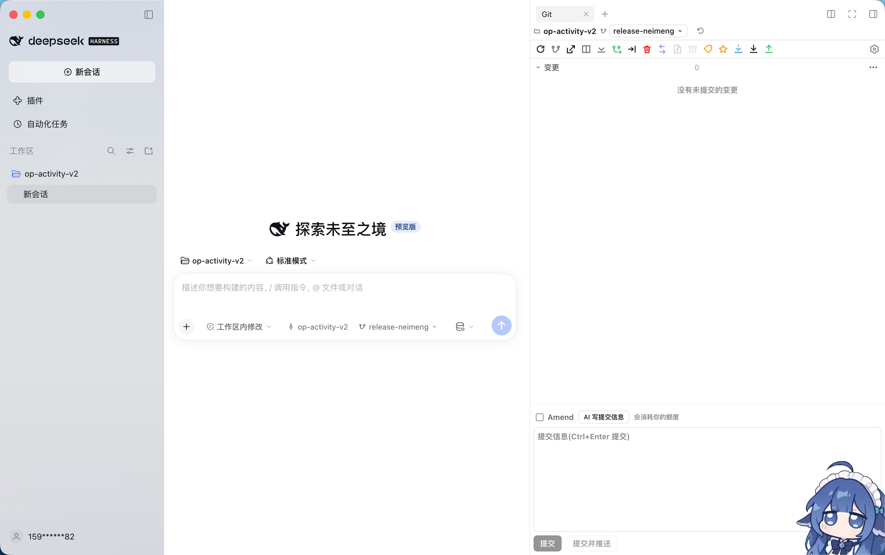
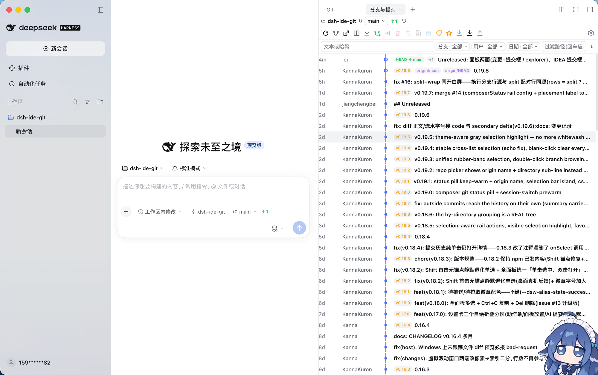

# dsh-ide-git

[](https://awesome-dsh-plugin.com)

[简体中文](README.md) | English

> An **IDE-grade Git tool window** for [DeepSeek Harness (DSH)](https://github.com/deepseek-ai/deepseek-harness) — the everyday tab holds just **changes + the commit box**, and the **branch button on the action rail** opens a second **explorer tab**: branch tree on the left, commit graph in the middle, commit details on the right, with JetBrains-style actions. Registered as a native [dsh-better-sidebar](https://github.com/omdsh-dev/DSH-better-sidebar) tab, usable in both the right sidebar and the bottom workbench; with no base plugin installed it falls back to DSH's own right sidebar, and it can also live in the **main conversation area** (a Git tab beside Chat/Trajectory, switchable off in settings).
>
> The explorer tab takes **no card slot on the sidebar's start page** — it exists for that branch button, and nothing else.

DSH's built-in Git panel covers stage / commit / revert / history. `dsh-ide-git` adds the layer IDE users expect: a **branch tree with a full context menu**, a **commit graph**, **commit details with per-file diffs**, a **grouped changes list** and a commit box — plus an SCM-style grouped command menu.

## Why it exists

- **Branches have no tree**: the built-in panel has a single dropdown. Here you get `HEAD / Local / Remote / Tags` groups, each branch with ahead/behind badges, upstream and a worktree marker (`W`).
- **History is just a list**: here it is a commit graph (lane topology plus ref badges) with infinite scroll, rubber-band multi-select and filters (text / hash / author / "me"). Double-clicking a branch browses its history without checking it out, and when the two branches meet in a merge the view anchors on that merge point.
- **Reading a commit's change**: clicking a commit opens its details — author, date, the full message, the changed files (with +/−) and a per-file line diff (gutters, hunk highlighting, red/green).
- **Pointing the AI at code**: select a few lines in a diff window, right-click, and send "which file, which lines" — with commit or worktree context — straight into the current session's composer.
- **Comparing branches**: right-click a branch and compare it with the current one; the result reports files and commit counts.
- **Actions have to be complete**: checkout, new branch from any branch or commit, rename, delete, merge into current, rebase current onto this, new tag, cherry-pick, revert, reset (keep / discard), fetch / pull / push (behind a confirmation) — plus the `⋯ more` menu grouped the SCM way (commit / changes / pull-push / remote / stash / tag), repository cloning and remote management. Those everyday commands no longer need a terminal.
- **Git right in the composer**: the input bar carries a repository/branch capsule (colored uncommitted / pullable / to-push counters). **Clicking the repository name opens the Git panel in the right sidebar**; the caret beside it picks a repository (a single-repo workspace has no caret, so the whole capsule is the door), and clicking the branch name switches branches — kept in sync with the panel both ways. Off-switch in the settings (on by default). Sessions are pre-warmed on switch so the panel opens instantly.

## Screenshots

> Two shots of the Git panel in the right sidebar of a **running DSH**: shot 1 is the **default tab** (changes + commit box) and shot 2 is the **explorer tab** (branches and commits — the commit list plus the graph). Both are the same registration and the same state; the **branch button** on the action rail switches between them.

<table>
<tr>
<td align="center" width="58%"></td>
<td valign="top"><b>Default tab: changes + commit box (right sidebar)</b><br/>A narrow, tall right column measures into the compact layout: one header line (repository capsule, branch switch, refresh) and a single <b>horizontal rail</b> below it — the <b>branch button</b> is the door to the explorer tab. The body is the changes area (the repository in this shot is clean, hence “no uncommitted changes”) and the <b>IDEA-shaped commit box</b>: <code>Amend</code> and the AI writer share the <b>line above</b> the message, and <b>Commit / Commit and push sit at the bottom left</b>. Dragging the box's <b>top edge</b> resizes it (double-click resets, arrow keys nudge).</td>
</tr>
</table>

<table>
<tr>
<td align="center" width="58%"></td>
<td valign="top"><b>Explorer tab: branches and commits</b><br/>The panel's other face (its tab is literally “branches and commits”). The commit list is in IDEA column order (<b>date → author → graph → refs → subject</b>) with the lane graph spanning whole rows, and the version tags plus a <code>HEAD → main</code> badge on the right. The filter row above it carries text or hash, branch or tag, author, date and path, plus a sort direction; double-clicking a branch browses its history without checking it out.</td>
</tr>
</table>

## Install

This plugin installs **from its repository address**:

```sh
# this plugin
dsh plugin --profile web add git+https://github.com/New2Niu/dsh-ide-git.git

# optional base plugin: it is what adds the bottom workbench and its sidebar chrome
dsh plugin --profile web add dsh-better-sidebar

# restart dsh web
```

DSH's own **Plugins** page accepts the same repository address — paste `git+https://github.com/New2Niu/dsh-ide-git.git` into its install field, or let the agent install it in a chat. This repository has no install-time build script, so pnpm's `allowBuilds` approval should not come into play; if a host does ask you to allow scripts, add the package name it prints to the profile's `pnpm-workspace.yaml` and retry.

Restart `dsh web`, then open any session:

- **plugin alone** — open the right sidebar from the session header and pick the **Git** capsule on the guide page; the rail's **branch button** opens the explorer tab beside it, and "Show diff" lands on the **Git Preview** tab in the same column;
- **with better-sidebar** — pick **Git** from the bottom panel's `+` menu, or from the native right sidebar's `+` menu (one registration, one state); its rail's **branch button** opens the explorer tab, and "Show diff" hands off to the base's own diff tab;
- with better-sidebar present the plugin also appears as a card in its settings page (side cards), where it can be disabled. The plugin's own switches live in DSH's **Git tool window** settings card (placement, composer status, action rail, AI commit message). The explorer tab is deliberately **not** in the `+` menu or on the start page: it is the branch button's own door.

### Compatibility

- `engines.dsh` is **`>=0.1.2-0`**: every DSH from 0.1.2 up, prereleases such as `0.1.5-rc` / `0.1.6-alpha` included (plain semver never matches a prerelease against a range, hence the `-0` floor). **The same value is also the `@deepseek-ai/dsh` peerDependency**: DSH 0.1.7+ enforces `@deepseek-ai/dsh*` peer ranges (an unsatisfied one keeps the plugin from loading) while nothing reads `engines`, so the peer is where the fact has to live. The range is an **open floor with no ceiling**, so no host from 0.1.7 on (prereleases included) can be rejected by it, and 0.1.0–0.1.6 never run that check at all.
- Three long-lived contracts, nothing else: the host's `webServer.register({ kind: 'prefix' })` route, the client's `window.__ModuleLoader__.load({ id, factory })`, and the client `slots` service. **Every icon is an inline SVG** (it does not import the `ui-primitives` icon set), so host icon changes cannot reach it; diff bodies prefer the host's own `DiffBlock` component and fall back to hand-drawn rows without it.
- better-sidebar is an **optional** peer: absent, broken, or waiting on its own upstream fix, the plugin still mounts in the native right sidebar.

## The panel: two faces, three seats

### Two faces (one registration, one state)

| Face | What is in it | How to open it |
|---|---|---|
| **Default tab** | **Changes + the commit box.** One column in all three chromes: the grouped changes on top, the commit box below, and the draggable divider between them is the box's own top edge | The **Git** card / `+` menu / guide capsule; or click the repository name in the composer |
| **Explorer tab** | **Branch tree \| commit graph \| commit details.** Under `columns` the three sit side by side (the detail column reuses the changes pane's width and divider, and shows a hint until you pick a commit); narrow / stacked puts the tree on top, swaps the list and the details in one main area, and the diff below | The **branch button** on the default tab's rail (the same button then toggles the branch tree inside the explorer). It is **not** in the `+` menu and takes **no** start-page card — it exists for that button |
| **Git Preview** | A line-level diff of one file or one commit patch, with copy-whole-patch, refresh and "open in file preview" (jumps to the host's whole-file reader) | Where "Show diff" lands: the native right sidebar's own tab when the base is absent, the base's diff tab when it is present, and an inline pane only when neither exists |

The panel never guesses: it measures itself with a `ResizeObserver` (width < 400px → `compact`, one header line and the rail as one row; width ≥ 600px and width ≥ 1.15 × height → `columns`; otherwise `stack`). **Width decides, height has no veto** — so a 1500×300 bottom workbench is never mistaken for a narrow column. Free-floating windows and the mobile drawer adapt too.

### Three seats (the registration happens once)

The plugin registers once; which surface it lands on is the **host's** decision, and the doors are exclusive:

| Host | When | What you get |
|---|---|---|
| **dsh-better-sidebar** (optional) | whenever it is installed | its tab system: the tab in the right sidebar **plus the bottom workbench**; the plugin also shows up as a card in its settings page |
| **DSH's own right sidebar** | automatically, when better-sidebar is absent | a **Git** capsule on the sidebar's guide page — the very same panel; the explorer and **Git Preview** open as extra tabs in that column on demand (neither declares a `guide`, so the start page keeps its single card) |
| **Conversation-area tab** (since v0.13.0) | always on (switchable in settings) | a **Git** tab beside Chat/Trajectory at the top of the conversation — clicking it turns the whole conversation area into the Git tool window; the switch lives in the plugin settings under Placement |

better-sidebar wins while it is there (it also carries the bottom workbench); a late-arriving better-sidebar takes the native registration down and hosts the tab itself, and a base that disappears at runtime falls straight back to the native seats instead of taking the panel with it. Installing this plugin alone is fully supported — no prerequisite.

| Surface | Shape | Layout here |
|---|---|---|
| Right sidebar (native, or bridged by better-sidebar) | narrow + tall | the default tab goes `compact`: single-line header, rail as one row, changes + commit box; the explorer tab goes `stack`: collapsible branch pane, commit list / details / diff swapping in one main area |
| Bottom workbench (better-sidebar only) | wide + flat | default tab: vertical rail + changes + commit box; explorer tab goes `columns`: tree · graph · details **side by side** — the JetBrains Git tool window shape |

## Features

- Action rail: a 16-action JetBrains-style strip (vertical in the bottom workbench, one horizontal row under the header in the right sidebar) with refresh, the branch button, float / split / full screen (rendered only where the host's dock service exists), new branch, checkout, delete, compare, show diff, stash, new tag, favorite, fetch, pull and push. **It shows as many buttons as fit**, folds the rest into a `⋯ more` menu, and pins a `⚙ settings` button that lets you reorder actions and toggle each of them (stored in `dsh-ide-git.rail.v1`, and the settings card carries the same switches). Every action lights up or greys out with the current state (no other branch → delete / checkout / compare off, no remote → fetch / push off, no upstream → pull off, no changes → diff off). **The branch button does two jobs**: on the default tab it opens the explorer tab, and inside the explorer it collapses / expands the leftmost branch column.
- Toolbar: repository picker, branch switch, ahead/behind, a chip naming an unfinished merge / rebase / cherry-pick / revert / bisect, "recently deleted (undo)", and a busy indicator while a git run is in flight; **Show Git output** in the `⋯` menu expands the argv, exit code, duration and output of the latest git runs, for self-diagnosis.
- `⋯ more`: an SCM-shaped grouped menu — **view and sort** (flat / by directory / by path / by name / by status / git order, expand all / fold all, show ignored files), **commit** (commit staged / commit all, plus amend and signed variants, undo last commit), **changes** (discard all changes), **pull and push** (sync, sync with rebase, pull with rebase, pull from remote, push / force push / push to remote, publish branch), **remote** (fetch from all remotes, add / remove remote), **branch** (delete a remote branch), **stash** (stash tracked / staged, apply / pop / drop a specific stash, drop all), **tag** (delete local / remote tag, push tags), clone, abort rebase, show git output.
- Repository: the workspace and the nested repositories under it are detected automatically; a repository picker switches between them in a multi-repo workspace, and a repository can be cloned (URL + target directory).
- Composer status pill: repository/branch capsule in the host input-bar tool row (colored uncommitted / pullable / to-push counters). **Clicking the repository name opens (and focuses) the Git panel in the right sidebar**; the caret beside it picks a checkout (a single-repo workspace has no caret, so the whole capsule is the door), and clicking the branch name switches branches — kept in sync with the panel both ways. Off-switch in the settings (on by default).
- Branch tree **(explorer)**: HEAD / Local / Remote / Tags / Favorites groups, filter box, ahead/behind badges, worktree marker; local blue / remote violet / tag amber / HEAD green.
- Branch context menu: checkout, rebase current onto this, merge into current, compare with current, new branch from here, rename, delete, fetch, push, send to chat (branch + repo); a rubber-band selection can delete the selected refs in one go.
- History filters **(explorer)**: text or hash, branch or tag, author (with a one-click "Me" entry), date (today / 7 days / 30 days / this year), an order toggle (newest / oldest first) and one-click clear; the path filter runs server-side (`git log -- <path>`) on Enter.
- Commit list **(explorer)**: IDEA column order — **date → author → graph → refs → subject**; a lane graph whose segments span whole rows (pixel-aligned across rows), a hollow dot for HEAD, refs badges (HEAD green / local blue / remote violet / tag amber, at most three plus `+n`), load more / infinite scroll (120 per page), rubber-band selection across all three lists.
- Commit context menu: details, copy revision, checkout revision, new branch here, new tag, cherry-pick, revert, reset here (keep / discard changes), send to chat (short hash + message + repo).
- Commit details **(explorer)**: full message, author/date, changed files with +/− and a per-file line diff; with ≥600px the list and the details sit side by side, in a narrow column the details replace the list behind a "back to history" button.
- Diff: the inline pane renders through DSH's own DiffBlock (red/green rows, copy / wrap toolbar), and the **Git Preview** tab uses the bundled LineDiff (unified double gutters or side-by-side, both sides highlighted, ± stats, a single side forced to unified, 5000-line truncation). The height is draggable and remembered per placement; **select diff rows and right-click** to send a line-level reference into the conversation.
- Changes: conflicts / staged / changes / untracked groups (with counts and ignored counts), inline stage / unstage / discard / copy name (multi-select), group-level stage-all / unstage-all, click for diff.
- Commit box, IDEA-shaped: **one row above the message** holds the **Amend** toggle (`--amend`) and the AI writer (amend first), the message is a multi-line textarea, and **Commit / Commit and push sit at the bottom left**. The box's **top edge drags** up and down to resize it (double-click resets, arrow keys nudge); Ctrl+Enter / Cmd+Enter commits — a bare Enter is a newline. AI generation asks before overwriting your draft and can be undone in one click.
- File context menu: show diff, stage / unstage, discard changes, copy path, send to chat (an `@file` reference chip or the raw path).
- Settings card: DSH's **Git tool window** card — **placement** (conversation-area Git tab, immersive mode), **composer Git status**, the **action rail** (per-action switches) and the **AI commit message** (model / reasoning effort / extra prompt; empty follows the current session).
- **Safety and undo**: deleting a branch, dropping a stash or discarding changes pops a toast in the corner with an **Undo** action — the delete is real, and undo recreates the ref from the object id (or the file byte snapshot) recorded just before it (one-shot, valid for 30 minutes); the toolbar's undo menu keeps the recent operations too. Deleting `main` / `master` / `trunk` requires typing the branch name, destructive dialogs focus Cancel instead of the red button, writes are serialised per repository on the host, and while a merge / rebase / cherry-pick / revert / bisect is still open the affected actions are greyed out with the reason. A force push uses `--force-with-lease`.

> The default tab holds the two things a day of commits needs — **changes + the commit box**. Everything marked **(explorer)** lives in the explorer tab, the panel's other face, opened by the **branch button** on the action rail.

## Send to chat

Everything in the panel can be right-clicked into the **current session's composer** — through DSH's official insertion channel (it appends at the tail without touching what you already typed; while sending, or when the service is absent, it falls back to copying the payload with a toast, never a dead click):

- **Commit** → `git commit 47ad017 "Subject" (repo xxx)`: short hash + message + repository, one sentence naming a revision;
- **Branch** → `git branch main (repo xxx)`;
- **File** (change rows and commit-detail file rows) → a `@path` file reference chip (DSH's native @ grammar, quoted paths included) or just the raw path;
- **Selected diff lines**: select some text in a diff window (opened from a commit detail or the working tree), right-click → **Send selected lines to chat**: an `@file` chip plus a line note — `lines N–M (commit 47ad017 "Subject" @ branch)` for a commit, `lines N–M (worktree, staged / uncommitted)` for the working tree. Numbers are reconstructed from the diff rows under the selection against the patch's hunk headers, in **new-file numbering**; a purely deleted span reports OLD numbers and says so. If the selection cannot be pinned to diff rows the menu degrades to **Send selected snippet to chat** (text truncated at 600 characters) instead of inventing numbers, and a **Copy the selection reference** item is always there. With no selection the browser's own menu stays.

Also in place: change-row and detail-file-row icons are tinted by extension (DSH's own FileTypeIcon); diff previews render through DSH's own DiffBlock (red/green rows, copy / wrap toolbar, host-consistent visuals); the diff window's height is draggable and remembered per placement; and the whole panel can live in the **main conversation area** — the Git tab next to Dialogue / Trace, switchable in the plugin settings.

## How it works

```
host half src/index.js                     client half src/client.js
  POST /dsh-ide-git/api/<method>             with the base: registerTab x2
  └─ spawn('git', argv, { cwd })              ├─ dsh-ide-git:panel    default (changes + commit box)
     └─ session workspace = cwd               └─ dsh-ide-git:explore  explorer (hidden)
        (passed as client scope.cwd)          without it: sidebarRightTabs.register x3
                                              ├─ ide-git            main panel (only guide capsule)
                                              ├─ ide-git-explore    explorer (no guide)
                                              └─ ide-git-preview    Git Preview (no guide)
                                            conversation: conversation.view tab (switchable)
                                            Panel: ResizeObserver -> columns / stack / compact
```

- **Host half** (`src/index.js`): one prefix route `/dsh-ide-git/api` with a 47-method table (`version` / `repos` / `summary` / `branches` / `log` / `commitDetail` / `diff` / `compare` / `stage` / `commit` / `merge` / `rebase` / `cherryPick` / `stash*` / `tag*` / `remote*` / `clone` / `gitLogs` / `undoList` / `undoApply` / …). Every git call is an argv array through `spawn` — no shell string, no `exec` — with argument validation (absolute paths, refs never start with `-`, no control characters, paths stay inside the repository).
- **Client half** (`src/client.js`): no build step, single file, `window.__ModuleLoader__.load({ id, factory })`, requiring only `react` (a DSH client baseline module).
- **Trust fence**: the route rides DSH's own web server, so it is same-origin by construction; only loopback Hosts, or browser requests marked `Sec-Fetch-Site: same-origin/same-site`, are served.
- **Destructive actions** (push, hard reset, force delete, discarding untracked files, dropping a stash) require an explicit `confirm: true` and always ask in the UI first (the only exception is the "commit and push" button, whose label already says it will push — it still passes `confirm: true` to the host).

## Interface language

Follows DSH's locale setting (`ctx.locale`) and switches live. **21 dictionaries** ship with the plugin: Simplified and Traditional Chinese (including `zh-HK` / `zh-MO` / `zh-TW`), English, Japanese, Korean, German, French, Italian, Portuguese, Russian, Dutch, Polish, Swedish, Turkish, Indonesian, Vietnamese, Thai, Hindi and Arabic. They are also published to DSH's locale registry through `ctx.locale.register`. Resolution is "exact tag → primary subtag → English", and **English is always the key-complete dictionary** — any language without a dictionary falls back to it rather than showing raw keys.

The dictionaries live in the `LOCALES` table inside `src/client.js`: one entry per language, each preceded by a `/* locale: <tag> */` marker. **The check is automatic** — a smoke test requires every dictionary to carry exactly the same key set as Chinese, because a missing key falls back to English silently and leaves the panel half-translated, which is what that test exists to catch.

## Limits / roadmap

- **Former roadmap items, now done**: rubber-band multi-select and batch operations, infinite scroll, favourited branches, double-click branch browsing, line-level diff references into the chat, and the plugin's own settings (placement / action rail / AI commit message) all ship today.
- **Still missing**:
  - changelists (grouping changes by intent and staging them into one commit);
  - interactive rebase (`rebase -i`), fixup / squash, patches (`format-patch` / `apply`);
  - a three-way merge conflict editor and conflict-resolution actions (take local / remote) — conflicted files today only get a group and a line diff;
  - blame / file history and line annotations;
  - fine-grained switches such as auto-refresh after commit and the diff context line count;
  - a worktree view (the branch row only marks occupancy).
- **`web` profile only**: `dsh.client.platform` is `web`; the desktop client's renderer reuses the same shell assets but has not been verified on a real machine.
- **It never writes `.git`**: every operation goes through the `git` command against the normal index and refs.
- **Large repositories**: the log is paginated (120/page) and diff output is capped at 400KB (truncated and flagged).

## Development

```sh
npm test   # four layers, 119 cases
#   smoke: file-level invariants — manifest consistency, the client wrapper, the require
#          whitelist, destructive-confirmation guards, the method table, the size core,
#          and dictionary key sets (every language compared key by key with Chinese)
#   api:   a real throwaway repository driven straight through the host route — parsing,
#          staging / commit / branches / tags / stash, every guard and the trust fence
#   graph: commit-graph lane layout
#   repos: workspace and nested-repository resolution
```

Real-machine regressions use the probes under `scripts/` (each needs an **isolated** instance: its own `DSH_HOME` and port — never the `dsh web` you are working in): `ssr-check` (server-render self-check of the client half), `layout-probe` (drags the container from 480 to 90px and records the chrome at each step, both faces), `panes-probe` (pane dragging and per-surface memory), `dock-probe` (float / split / full screen), `selection-probe` (rubber-band select and batch actions), `conversation-probe` (the conversation-area seat and the commit box's top-edge drag), `settings-card-probe` (the settings card); `demo-repo.mjs` builds the demo repository and `screenshots.mjs` takes its six demo shots (the two real-instance images the README shows are not among them).

Local iteration: add the repository to a web profile and restart `dsh web`; client-half changes are hot-loaded by DSH, host-half changes need the restart.

## License

MIT © KannaKuron
